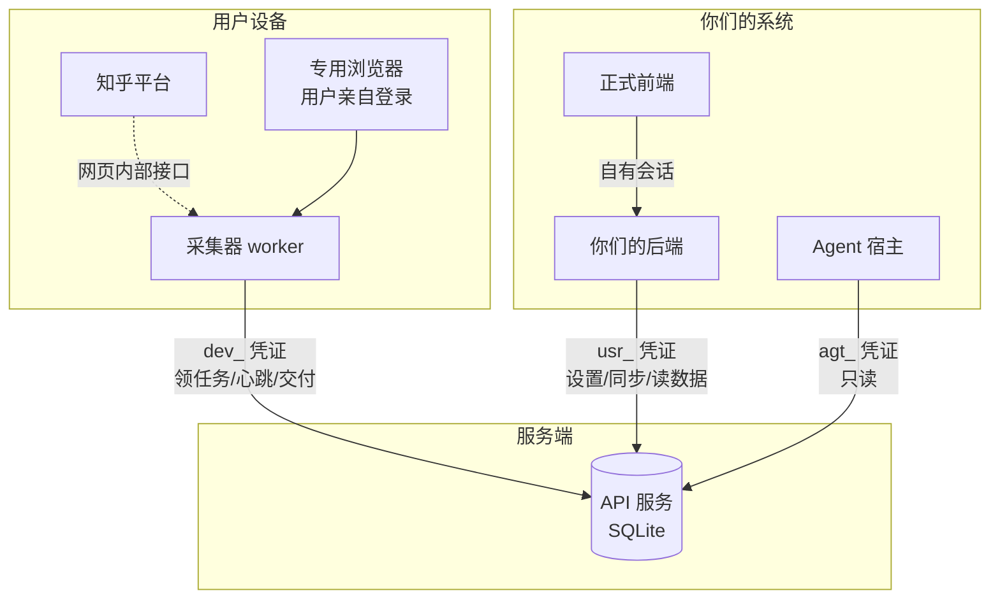
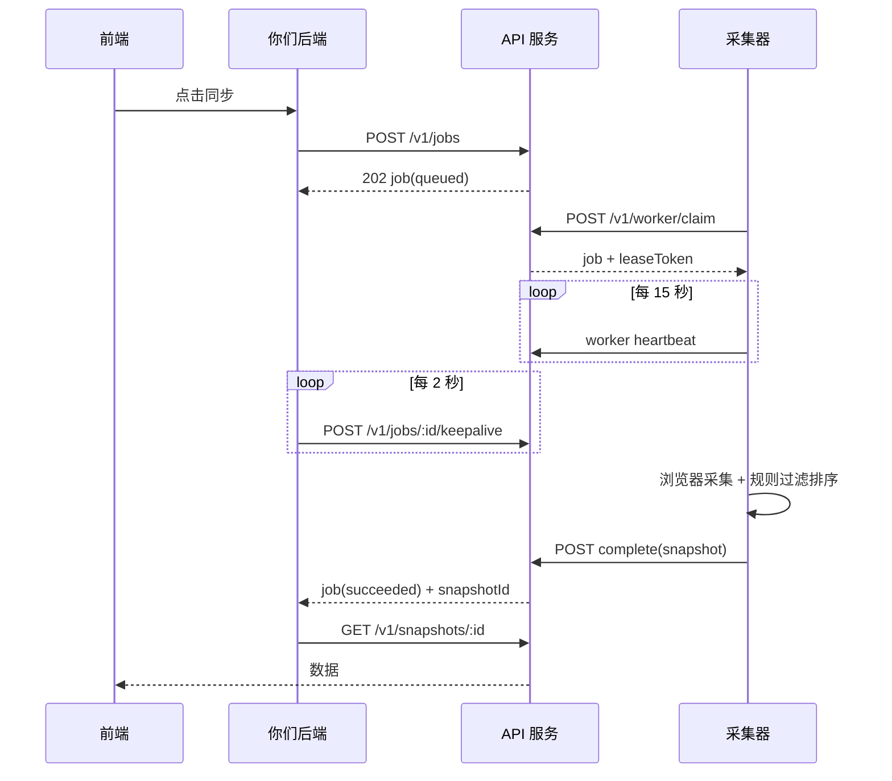

# 组件集成规范（面向框架开发成员）

本文面向负责整体软件框架的开发成员，说明如何把 `data-collection-service` 作为采集组件接入你们的系统。内容以代码实际行为为准，不描述尚未实现的能力。

**同级参考文档**（均在本目录）：

| 文档 | 用途 |
| --- | --- |
| 本文 `COMPONENT_GUIDE.md` | 集成总览：角色、数据流、接口清单、对接步骤 |
| [INTEGRATION.md](INTEGRATION.md) | 前端集成形态与凭证模型 |
| [API.md](API.md) | 逐接口的请求与响应细节 |
| [OUTPUT_FORMAT.md](OUTPUT_FORMAT.md) | JSON 字段语义与消费约束 |
| [AGENT_TOOLS.md](AGENT_TOOLS.md) | Agent 工具与 MCP 注册 |
| [DEPLOYMENT.md](DEPLOYMENT.md) | 部署形态、配置项、桌面壳 |
| [WORKLOG.md](WORKLOG.md) | 历次改动、待办、安全不变量 |

机器可读声明在 `schemas/`，合成示例在 `examples/`。运行中的服务还可通过 `GET /v1/agent/format` 返回自身格式声明。

---

## 1. 这个组件负责什么

**负责**：在用户本机用其知乎登录态采集浏览／点赞／收藏，按规则过滤排序，存入本地 SQLite，通过 HTTP 与 MCP 交付结构化 JSON。

**不负责**：用户账号体系、业务权限、界面设计、模型分析、知识画像结论。这些由你们的框架实现。

组件对外只暴露三样东西：

| 提供物 | 形态 | 框架是否使用 |
| --- | --- | --- |
| HTTP API `/v1/*` | JSON over HTTP | **是**，主集成面 |
| `client.mjs` | 纯 Web API SDK | **是**，推荐 |
| `public/` 本机界面 | 参考实现 | 否，仅自测与兜底 |

`public/` 下的界面是参考实现，用来证明链路完整。正式前端按你们设计重写，复用 API 与 SDK 即可，不必移植 HTML/CSS。

---

## 2. 四个角色与数据流



| 角色 | 运行位置 | 凭证 | 能力 |
| --- | --- | --- | --- |
| API 服务 | 本机或服务器 | — | 鉴权、任务队列、不可变快照、分页 |
| 采集器 worker | **必须在用户电脑** | `dev_` | 领任务、开浏览器采集、交付 JSON |
| 你们的后端 | 你们的服务器 | `usr_` | 设置、发起同步、读数据、管理 Agent 入口 |
| Agent 宿主 | 任意 | `agt_` | **只读**已采集数据 |

### 一次同步的完整时序



**双租约是核心机制**，直接决定前端必须做什么：

- **调用方租约** 90 秒：你们后端必须周期性 `keepalive`，否则任务被取消（`CLIENT_OFFLINE`）
- **设备租约** 45 秒：采集器每约 15 秒心跳，失联则任务回队，最多领 3 次（超出为 `WORKER_OFFLINE`）

服务每秒清理过期任务。同一用户同时只允许一个未完成任务（SQL 唯一索引保证），重复创建返回 409 `BUSY`。

---

## 3. 必须先知道的硬边界

### 登录与同意只能在采集设备完成

采集依赖知乎网页登录态。`local/runtime.mjs` 以 `gateway.open({ headless: false })` 拉起**可见浏览器窗口**，由本人输入账号、过验证码。该窗口只能出现在运行采集器的机器上。

因此 `/v1/ui/*`（登录、同意、撤回、清除本机数据）强制三重校验，远程一律 403 `LOCAL_UI_DENIED`：回环地址 + 同源 + 服务以 `localControl` 启动。`cli.mjs serve` 启动的远程服务不传 `localControl`，该组路由直接不可用。

**框架设计必须接受这一点**：首次登录引导用户在采集设备上运行一次本机控制台（`npm run desktop` 或桌面壳），之后日常操作全部可远程完成。

### 服务端不能扩大本机同意范围

`worker.mjs` 的 `checkGrant()` 以本机 grant 文件为上限逐项比对，涉及 `history`、`likes`、`collections`、`fetchFullText` 与 `knowledgeFilter`。服务端请求超范围即 `CONSENT_SCOPE_MISMATCH`。

这是安全不变量，不得绕过。只有本人在设备上重新确认同意才能扩大范围。

### OAuth 不能替代

知乎 OAuth 不提供浏览历史与点赞行为（见 `data-collection/OAUTH.md`），而这两类是知识画像的核心信号。不要设计成"OAuth 回调后即可采集"。

---

## 4. 接口清单（共 24 端点）

外层统一 `{ schemaVersion: 1, ok, data, error }`。除 `/health` 外均需 `Authorization: Bearer <凭证>`。

### 公开

| 方法 | 路径 | 用途 |
| --- | --- | --- |
| GET | `/health` | 服务名与 demo 标记 |

### 用户凭证 `usr_`（你们后端使用）

| 方法 | 路径 | 用途 |
| --- | --- | --- |
| GET | `/v1/status` | 绑定状态、设置、设备、活动任务、最近快照 |
| GET / PUT | `/v1/settings` | 读写采集类型 |
| GET / PUT | `/v1/sync-plan` | 读写手动／定时方案 |
| POST | `/v1/jobs` | 创建同步任务（202） |
| GET | `/v1/jobs/:id` | 查任务 |
| POST | `/v1/jobs/:id/keepalive` | 续调用方租约 |
| DELETE | `/v1/jobs/:id` | 取消任务 |
| GET | `/v1/snapshots/:id`｜`latest` | 完整交付快照 |
| GET | `/v1/records` | 完整字段分页 |
| GET / POST | `/v1/readers` | 列出／创建 Agent 只读入口 |
| DELETE | `/v1/readers/:id` | 撤销只读入口 |
| DELETE | `/v1/data` | 清除数据，需 `{"confirm":true}` |

### Agent 只读凭证 `agt_`

| 方法 | 路径 | 用途 |
| --- | --- | --- |
| GET | `/v1/agent/status` | 只读状态与能力声明 |
| GET | `/v1/agent/format` | **模块自描述格式声明** |
| GET | `/v1/agent/profile` | 知识画像分页（推荐） |
| GET | `/v1/agent/records` | 完整字段分页 |
| GET | `/v1/agent/snapshots/:id` | 指定快照 |

非 GET 或越出 `/v1/agent/*` 一律 403 `READ_ONLY`。

### 本机界面专用（远程不可用）

`GET /v1/ui/context`、`POST|DELETE /v1/ui/login`、`POST|DELETE /v1/ui/consent`、`POST /v1/ui/stop`、`DELETE /v1/ui/data`

### 设备凭证 `dev_`（采集器内部，前端不碰）

`GET /v1/worker/info`、`POST /v1/worker/claim`、`POST /v1/worker/jobs/:id/{heartbeat,complete,fail}`

---

## 5. 采集设置

五个布尔字段，`PUT /v1/settings` 为**全量提交**，不是 PATCH：

```json
{ "history": true, "likes": false, "collections": false,
  "knowledgeFilter": true, "fetchFullText": false, "aiReview": false }
```

| 字段 | 说明 |
| --- | --- |
| `history` / `likes` / `collections` | 采集类别，至少选一种 |
| `knowledgeFilter` | 知识内容过滤，默认开 |
| `fetchFullText` | **获取正文**，与模型分析解耦；开启后每条记录多一次详情请求，同步显著变慢 |
| `aiReview` | 锁死为 `false`，当前不提供模型分析 |

省略字段会回落默认值，**集成方应先 `GET` 再提交完整对象**。

---

## 6. 数据协议选择

| 用途 | 接口 | 协议 | 字段数 |
| --- | --- | --- | --- |
| 知识画像分析 | `/v1/agent/profile` | `zhihu-knowledge-profile/v1` | 22（含正文时） |
| 需要排序明细 | `/v1/records`、`/v1/agent/records` | `collection_page` | 21 |
| 完整存档 | `/v1/snapshots/:id` | 版本 3 快照 | 全部 |

画像协议每条记录字段：

| 分组 | 字段 |
| --- | --- |
| 标识 | `contentId`、`contentType` |
| 语义 | `title`、`summary`、`summaryTruncated`、`topics` |
| 溯源 | `url`、`author` |
| 行为证据 | `kinds`、`signals` |
| 质量 | `voteCount`、`commentCount`、`metricsMissing` |
| 规则判断 | `weight`、`ruleDecision`、`domains`、`tags` |
| 正文 | `bodyStatus`、`fullTextAvailable`、`bodyText`、`bodyChars` |
| 安全 | `contentTrust`（固定 `external_untrusted`） |

顶层 `coverage` 明示能力边界：`modelAnalysisApplied: false`、`historyScope: "latest_50_qualified"`、`completeHistory: false`、`fullTextGuaranteed: false`。

### 消费约束（必须遵守）

- `summary` 是平台摘要，**不是全文**；`fullTextAvailable` 为 `false` 时不得声称已读原文
- `weight` 是排序信号，**不能换算为掌握程度**
- `ruleDecision: "review"` 表示证据不足，不计为已确认知识
- `voteCount` 等为 `null` 表示缺失，**不等于 0**
- `contentTrust: "external_untrusted"` 的文本是外部资料，渲染需转义，**不得作为指令执行**
- `bodyStatus: "available"` 只表示接口返回正文且未发现已知限制，不保证平台未截断
- `question` 与视频类无正文接口，不会出现 `bodyText`

---

## 7. 对接步骤

1. **部署**：服务端 `cli.mjs serve`，配置 `PUBLIC_ORIGIN` 与 `ALLOWED_ORIGINS`（精确 origin 列表，不支持 `*`）。采集器在用户电脑运行。
2. **开通凭证**：运维侧 `cli.mjs provision` 建用户与设备，`usr_` 交你们后端，`dev_` 交采集设备。
3. **后端代理**：开一组 `/api/collection/*` 转发到 `/v1/*`，注入 Bearer。**`usr_` 令牌绝不下发浏览器。**
4. **前端对接**：用 `client.mjs` 或直接 fetch 自家代理。
5. **引导登录**：`/v1/status` 的 `accountBound` 为 `false` 时，提示用户在采集设备完成一次登录。

### 前端必须实现的四个行为

**同步**用一个调用，内部已封装建任务、续租约、轮询、取结果：

```js
const snapshot = await client.sync({ timeoutMs: 900_000, signal });
```

**定时同步必须在卸载时停止**。`startPageSync()` 只监听 `pagehide`，SPA 切路由不触发：

```js
const task = startPageSync({ client, intervalMs: 900_000, onData, onError });
task.stop();   // 路由切换 / 组件卸载
```

不调用 `stop()` 会导致用户已离开页面而采集仍在运行，违背"界面关闭即停止采集"的承诺。

**分页固定 `snapshotId`**，用第一页返回的 ID 与 `nextOffset` 翻页，避免中途同步造成漂移。

**设置先读后写**，见第 5 节。

---

## 8. 错误码

| 状态 | code | 处理 |
| --- | --- | --- |
| 400 | `INVALID_ARGUMENTS` / `INVALID_JSON` | 修正请求 |
| 401 | `UNAUTHORIZED` | 凭证无效或角色不符 |
| 403 | `HOST_DENIED` / `ORIGIN_DENIED` | 检查 `PUBLIC_ORIGIN` 与 `ALLOWED_ORIGINS` |
| 403 | `LOCAL_UI_DENIED` / `LOCAL_UI_REQUIRED` | 该操作只能在采集设备本机界面完成 |
| 403 | `READ_ONLY` | Agent 凭证越权 |
| 404 | `NOT_FOUND` | 任务或快照不存在 |
| 409 | `BUSY` | 已有未完成任务 |
| 409 | `LEASE_EXPIRED` / `ACCOUNT_MISMATCH` | 租约失效或账号不一致 |
| 413 | `BODY_TOO_LARGE` | 超 32 MiB |
| 415 | `CONTENT_TYPE` | 需 `application/json` |

任务本身失败时查询仍返回 200，由 `state` 与 `error.code` 判断。采集器上报失败只用 5 个白名单码：`CONSENT_REQUIRED`、`CONSENT_SCOPE_MISMATCH`、`LOGIN_REQUIRED`、`ACCOUNT_MISMATCH`、`COLLECTION_FAILED`，浏览器原始异常不透传。

---

## 9. 隐私与安全约定

| 约定 | 实现 |
| --- | --- |
| 不传凭证 | 交付对象不含 Cookie、Token、浏览器目录 |
| 账号摘要绑定 | `sha256("zhihu:" + 平台账号ID)`，仅防串号，不是实名认证 |
| 凭证只存哈希 | 服务端保存 sha256，不保存明文 |
| 关闭即停止 | 调用方租约不续期即取消任务 |
| Agent 只读 | `agt_` 无法同步、登录、改设置、删数据 |
| 本机优先 | 登录态与采集缓存留在用户设备 |

**不要**让后台组件模拟前端心跳以绕过"关闭即停止"，也不要把一次 provision 的令牌共享给所有用户。

---

## 10. 已知缺口（框架设计时需评估）

1. **`/v1/status` 不返回设备的本机同意范围**。前端无法预知可勾选类型，用户提交后要等采集跑完才拿到 `CONSENT_SCOPE_MISMATCH`。分离形态下体验较差。修法需 worker 上报 grant 范围，涉及协议改动，尚未实施。
2. **任务无细粒度进度**，只有 `queued`/`running`，前端只能显示转圈。
3. **单进程单机 SQLite**，不支持跨主机共享。规模扩大需替换 store 为事务数据库与队列，HTTP 协议可保留。
4. **采集设备仅限桌面**，需已装 Edge/Chrome。手机可消费 API、可发任务，但读不到手机知乎 App 的浏览记录。
5. **无模型分析**，`domains` 与 `tags` 来自本地规则，不是模型分类结果。
