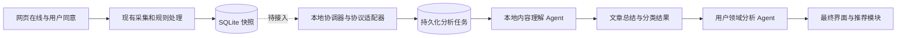

# 知乎数据采集与本地 Agent 对接

正式星图可以继续使用此工作台原来登记的 `/auth/zhihu/callback`。从星图发起的登录完成后回到本机 `3006`，从旧采集页发起的登录仍回到采集页。配置与启动步骤见[正式星图说明](../../agent/README.md)。


Agent 解析当前浏览、点赞、收藏输出前，请阅读 [OUTPUT_FORMAT.md](OUTPUT_FORMAT.md)，并参考 [JSON Schema](schemas/collection-output.schema.json) 与 [完整合成样例](examples/history.snapshot.json)。本次正式对接协议为版本 3，OAuth 补充链路的新改动暂未发布。

本机网页支持选择获取知乎浏览、点赞和收藏信息，按指定规则筛选、计算权重并写入 SQLite，同时提供 JSON 导出。项目也保留了 OAuth 接入原型，可在赛事开放项目凭证后继续联调公开创作和收藏接口。

第一阶段计划部署本地 Agent，默认数据留在本机。当前已实现采集、规则处理、网页在线限制和版本 3 JSON 快照；独立 Agent 协调器、持久化任务队列和用户领域分析尚未实现。Ollama 适配代码已预留但未部署模型、未启用。

首次运行先看[本机采集快速开始](#本机采集快速开始)，其他模块开发者重点阅读[本地 Agent 对接设计](#本地-agent-对接设计)。其中标为“待实现”的协议、表和交接点不能当作现有接口调用。

## 本机采集快速开始

当前真实采集主要在 Windows＋Edge 环境验证。需要 Node.js 24+ 和已安装的 Microsoft Edge，macOS／Linux 需要另外验证，手机不能直接运行桌面采集程序。Ollama 不是当前启动与规则过滤的必需依赖。

在项目根目录运行以下 PowerShell 命令，已有 `.env` 时不覆盖：

```powershell
npm ci
if (-not (Test-Path -LiteralPath '.env')) {
  Copy-Item -LiteralPath '.env.example' -Destination '.env'
}
npm start
```

打开 <http://127.0.0.1:3000/history>，设置入口为 <http://127.0.0.1:3000/settings>。当前采集链路无需填写 OAuth 应用凭证。使用者必须在专用窗口亲自登录知乎，并同意获取所选信息。

仅至少一个同步页或设置页保持有效连接时允许采集；关闭最后一个应用页面后停止，Node 服务保留待机。已保存的快照、知乎登录会话和自动同步偏好会保留。

```powershell
npm test
```

测试覆盖同步、过滤、权重、页面租约、多标签页及模型适配的模拟流程；真实模型效果和跨设备兼容性不由这些测试保证。

## 本地演示

需要 Node.js 24 或更高版本。先停止占用同一端口的服务，再运行 `npm run demo`，打开 <http://127.0.0.1:3000/history>，通过同样的设置、连接和同步流程体验示例数据。演示进程仅监听本机，使用独立的 `.data/demo.sqlite`。若需体验早期 OAuth 原型演示，可访问根路径 `/`。

## 保留的 OAuth 原型（暂不用于本地 Agent）

本节属于 `/`、`zhihu.mjs` 和 `/api/zhihu/*` 的早期原型，与本机 `/api/history/*` 采集链路使用不同会话和输出格式。当前本地 Agent 应以版本 3 的采集快照为主。

1. 复制 `.env.example` 为 `.env`，配置赛事项目的 `ZHIHU_OAUTH_APP_ID`、`ZHIHU_OAUTH_APP_KEY`，以及知乎开放平台个人中心分配的 `ZHIHU_ACCESS_SECRET`。
2. 将 `APP_ORIGIN` 配置为网站根地址，在赛事项目登记相同地址加 `/auth/zhihu/callback` 作为回调。公网部署应通过 HTTPS 反向代理，并避免在回调访问日志中记录查询参数。
3. 运行 `npm start`，在浏览器访问 `APP_ORIGIN`，通过知乎页面完成授权。回调成功后后端自动同步，也可在网页点「重新同步」。若部署需要跨容器保留数据，将 `DATA_FILE` 指向持久卷中的文件。

回调需拿到与发起登录相同的 `state`。知乎官方开发包记录过历史版本未回传该字段，真实联调时应先验证赛事应用的实际回调。缺少或不匹配时服务会终止登录。知乎文档未公布刷新令牌流程，现有用户 Token 过期后需重新连接才能再同步。

[赛事 OAuth 说明](https://hackathon-s3.event.zhihu.com/) · [知乎官方开发包](https://developer-cdn.zhihu.com/zhihu-cli/releases/stable/skill/zhihu-cli-skill.zip)

## OAuth 原型的数据传输

| 路径 | 用途 |
| --- | --- |
| `GET /api/zhihu/data` | 网页读取当前登录用户的快照 |
| `GET /api/zhihu/export` | 下载相同的 JSON 快照 |
| `POST /api/zhihu/sync` | 用当前用户有效的知乎授权重新同步 |
| `POST /api/zhihu/disconnect` | 清除网站端会话及该用户的 SQLite 快照 |

快照格式为 `{ source, profile, syncedAt, creations, collections }`。正式模式默认保存到 `.data/zhihu.sqlite`。归档到专用数据仓库时，可以由后端在同步成功后写入指定的私有对象存储或数据库。Git 仓库适合存放代码和演示样例，真实用户的授权令牌和同步数据应保存在访问受控的数据存储中。

应用密钥和访问令牌只由后端使用。此原型的会话和令牌驻留在单个进程内，服务重启后需要重新连接；已同步快照会保留。最近浏览通过下述本机采集模块同步。

## 浏览、点赞和收藏的获取与传输

运行 `npm install` 后执行 `npm start`，打开 <http://127.0.0.1:3000/history>。最近浏览模块使用本机专用 Edge 窗口，首次需要电脑上已安装 Microsoft Edge。可通过 `HISTORY_BROWSER_CHANNEL=chrome` 使用已经安装的 Google Chrome。

1. 打开 <http://127.0.0.1:3000/settings>，勾选浏览、点赞和收藏中需要的信息并保存。新增类别默认关闭，已有用户继续使用浏览记录设置。
2. 在同步网页勾选同意采集，点击「打开知乎登录」。
3. 在专用窗口中亲自完成知乎登录。登录状态保存在 `.data/history-profiles/` 下的独立目录中。
4. 回网页点击「立即同步」，后端先核对当前知乎账号，再分页读取所选信息，同步完成后关闭采集浏览器。
5. 需要定时获取时，勾选每 5 分钟自动检查，再开始同步。采集仅在至少一个同步页或设置页保持连接时运行。关闭最后一个应用页面后，取消当前采集并停止定时采集；重新打开后可按已保存的自动同步设置恢复。知乎窗口无需常开，但应用网页和本机服务需要保持运行。服务重启后，网页未重新连接时不会执行采集。
6. 在网页查看按权重排列的记录，或下载 JSON。暂停会停止当前采集提交与后续自动任务。断开会停止采集、关闭专用窗口并撤回本网站的采集同意。删除本机记录会另外清除数据库中该数据源的数据。

此链路使用用户在专用窗口内建立的知乎网页登录会话。网页登录与本网站的采集同意都由用户完成。会话保存在本机浏览器目录中，断开后再次连接可继续使用有效的登录状态。模块只在本机地址运行，网页端通过自己的 HttpOnly 会话 Cookie 访问对应的数据源。

网页开启状态由 SSE 连接与心跳共同确认，服务每 10 秒发出心跳，网页确认后续期 30 秒。正常关闭或离开页面会关闭连接，并尝试发送关闭通知；浏览器崩溃、页面冻结或网络中断时，最后一次确认超过约 30 秒后停止采集。服务每秒清理过期连接，并在每个采集步骤和最终写入前检查连接，因此关闭后到达的结果不会作为新快照提交。多个标签页按同一本机会话分别计数；切到其他标签或最小化不主动停止，连接失效时暂停。Node 服务保留待机，用户数据、知乎会话和自动同步偏好继续保存。

历史接口来自知乎网页自身的最近浏览功能，其实现参考 [zhihu-history](https://github.com/maxchang3/zhihu-history/blob/main/src/services/api.ts)。每次同步按平台最近浏览的时间顺序读取，在过滤用户主页和低互动回答后，达到 50 条不同帖子时停止，记录不足时读取到平台列表结束。点赞分页遍历当前账号可见的赞同动态，收藏遍历账号自己的全部可见收藏夹和条目，两者均读取到分页结束。可获取的历史范围由平台实际响应决定。登录失效、验证提示、限流或接口变化会在网页显示，之前成功保存的数据会保留。

每条记录包含 `contentId`、`contentType`、`title`、`summary`、`author`、`url`、`sourceReadTime`、`observedAt`、`voteCount`、`commentCount`、`topics`、`kinds`、`signals`、`weight` 和 `weightDetails`。`sourceReadTime` 保留平台返回的秒级浏览时间，`observedAt` 为本次采集时间。`kinds` 与 `signals` 记录一个帖子对应的浏览、点赞和收藏来源。每批数据在全部所选类别获取完成、账号校验通过后以事务写入。

回答在点赞数小于 5 且评论数小于 2 时被排除，缺失任一指标时保留并标注。浏览记录先取时间最新的 50 条合格帖子，随后与点赞、收藏合并，同一帖子只保留一个排序条目。最终权重采用以下公式。

```text
最终权重 =（类型权重 × 行为系数 + 互动加分 + 主题加分）× 时间系数
类型权重 = 想法 1，文章 2，回答 3
行为系数 = 点赞或收藏 4/3，浏览 1
互动加分 = min(1, ln(1 + 点赞数 + 2 × 评论数) / ln(1001))
主题加分 = 0.5 × 其他不同的相似帖子数
时间系数 = 纯浏览超过 14 天 0.7，超过 7 天 0.9，其余 1
```

点赞或收藏来源的时间系数固定为 1，多种来源不会重复叠加行为系数。相似判断优先比较知乎话题标签，缺少标签时采用标题分词集合，至少 2 个共同关键词且 Jaccard 重合比例不低于 35%。问题、视频等尚未指定类型权重的内容保留为 `weight=null` 并排在有权重的记录后面。所有得分明细都随 JSON 导出。

当前原始类别数据保存在 SQLite 的 `history_datasets`，按权重排列的最终结果保存在 `history_rankings`。修改设置时会重新计算所选缓存数据的排序，关闭的类别仍保留本机缓存，后续同步只更新勾选类别。旧版浏览数据会自动纳入新排序。将全部类别关闭时，自动同步会暂停。

| 路径 | 用途 |
| --- | --- |
| `GET /api/history/session` | 建立本机网页会话并读取连接、采集和自动同步状态 |
| `GET /api/history/page?id=...` | 建立页面 SSE 连接，限定采集运行范围 |
| `POST /api/history/page/heartbeat` | 确认页面心跳，延长连接有效期 |
| `POST /api/history/page/close` | 释放当前标签页连接，最后一页关闭时停止采集 |
| `POST /api/history/connect` | 接收明确采集同意并打开专用知乎窗口 |
| `GET /api/history/settings` | 读取当前信息种类设置 |
| `GET /api/history/agent` | 检查预留 Ollama 适配器的配置与可用状态 |
| `POST /api/history/settings` | 保存勾选种类，并确认所选数据的获取用途 |
| `POST /api/history/sync` | 获取所选信息，接收 `autoSync` 布尔值 |
| `GET /api/history/data` | 网页读取当前会话的记录 |
| `GET /api/history/export` | 下载相同数据的 JSON 文件 |
| `POST /api/history/pause` | 暂停采集与自动任务 |
| `POST /api/history/disconnect` | 断开并撤回本网站采集同意 |
| `POST /api/history/clear` | 断开并清除本机记录 |

`npm run demo` 中的 `/history` 页面提供相同的获取、存储和导出流程，使用标明来源的示例记录。

## 知识内容筛选原则

知识过滤默认开启，对浏览、点赞和收藏都生效。以内容是否提供解释、方法、证据、技能或可迁移经验为判断原则，涵盖技术、科学、医学、心理、历史、文学、法律、社会、教育和生活实践。领域标签和点赞量不代表知识价值；规则判断也不代表事实已被核实。

明确排除以猎奇刺激、擦边叙事、八卦情绪、纯故事消费、个人流水账、纯娱乐消费评价或无实质信息为主，且未显示知识分析的内容。例如“是什么让你感到人和禽兽没有区别？”对应的猎奇叙事会被排除。医学性教育、犯罪研究、文学分析、游戏设计等具有实质解释或分析的内容不会因敏感词被整类屏蔽。规则会结合标题、可用摘要／正文和话题，无法确定时保留并标记为“待复核”。这种启发式判断可能误判，排除理由会保留供检查。

采集时先筛选，再计算合格浏览记录数，排除项不占 50 条名额；达到 50 条后停止。主结果 `records` 用于知识内容排序，`excluded` 为独立审查列表，不参与主题加分或权重排序。原始缓存保留，修改筛选设置可重新计算，避免不可逆删除。已保存的旧数据会在读取时按新版规则自动重新筛选。

JSON 快照升级为 `schemaVersion: 3`，新增 `policyVersion`、`excluded` 和每条记录的 `analysis`。其中 `decision` 为 `keep`、`exclude` 或 `review`；`method: rules` 表示本地规则，`reason` 为判断理由，`domains` 为粗粒度领域候选。规则不会伪装成模型生成总结，也不会根据阅读记录直接认定用户已掌握相关知识。

本机 Ollama 全文分析的适配代码暂作预留，当前未部署模型、默认关闭。后续可通过 `CONTENT_AGENT_OLLAMA_URL` 和 `CONTENT_AGENT_MODEL` 配置本机服务，再启用 `aiReview`。只允许回环地址并拒绝已识别的远程／cloud 模型；不发送知乎会话。正文可用时逐段分析后汇总，记录覆盖字符数和段数，并输出关键词、标签、领域和知识点；正文缺失、已知截断或访问受限时不生成全文总结。模型失败则回退规则并标注。全文范围是接口实际返回的正文，评论和图片不在此范围内。该适配的协议和错误处理经过模拟测试，真实模型效果待后续联调。

## 本地 Agent 对接设计

### 1. 模块职责与实现状态

| 模块 | 代码／位置 | 职责与状态 |
| --- | --- | --- |
| 应用入口 | `server.mjs` | 已实现：HTTP、会话、路由、模块组装 |
| 采集调度 | `history-collector.mjs` | 已实现：账号校验、浏览器网关、定时任务、暂停与取消 |
| 平台适配 | `zhihu-sources.mjs` | 已实现：浏览、赞同动态、收藏分页与元数据补充 |
| 内容处理 | `content-policy.mjs`、`record-ranking.mjs` | 已实现：知识规则、标识、去重、主题与行为权重 |
| 存储 | `history-data.mjs` | 已实现：标准化、SQLite 事务、缓存与版本 3 快照 |
| 页面许可 | `page-presence.mjs`、`public/page-session.js` | 已实现：SSE、确认心跳、关闭通知与租约过期 |
| 串行模型适配 | `content-agent.mjs` | 已预留：本机 Ollama 分段正文分析，当前关闭 |
| Agent 协调器 | 尚无对应模块 | 待实现：稳定用户映射、快照交接、任务编排、取消、重试与结果提交 |
| 内容理解 Agent | 可复用预留适配，但需独立封装 | 待实现：独立任务处理、正文总结、分类与证据引用 |
| 用户领域分析 Agent | 尚未实现 | 消费文章分析和用户行为，输出接触领域、关注主题与不确定性 |
| 推荐与最终界面 | 由最终项目提供 | 消费用户分析结果，展示依据和数据时间 |

`server.mjs` 会直接启动服务，不是可以无副作用导入的 SDK。不要在 Agent 中直接导入它。应由应用入口持有 Store、采集器和页面许可实例，再向新协调器显式传入依赖。

推荐本机对接路线如下；图中的协调器、任务表和后续分析链路尚未实现：



### 2. 当前版本 3 快照的消费约定

| 字段 | 含义与消费要求 |
| --- | --- |
| `schemaVersion`、`policyVersion` | 数据协议与规则版本；当前协议为 `3` |
| `source` | 真实为 `zhihu_selected_data`，演示为 `demo_history` |
| `account.nickname` | 展示昵称，不能作为稳定的业务用户 ID |
| `syncedAt`、`revision` | 最近成功采集时间与整个快照指纹 |
| `settings` | `history`、`likes`、`collections`、`knowledgeFilter`、`aiReview` |
| `records`、`excluded`、`counts` | 主结果、独立审查项、主结果各来源数量；同一帖可计入多个来源 |
| `contentId`、`contentType`、`key` | 帖子标识与类型，ID 一律按字符串处理，避免长整数精度丢失 |
| `title`、`summary`、`author`、`url` | 平台文本与来源；`summary` 是平台摘要 |
| `sourceReadTime` | 秒级浏览时间戳字符串或 `null`，不是阅读时长 |
| `observedAt` | 成功采集时的 ISO 时间字符串 |
| `kinds`、`signals` | 合并后的浏览／点赞／收藏来源与各来源时间；来源时间格式可能为秒级数值、字符串或 `null` |
| `voteCount`、`commentCount`、`metricsMissing` | 互动指标与缺失标记；缺失不等于零，评论数不是评论正文 |
| `topics`、`weight`、`weightDetails` | 平台话题及排序信号，不是知识掌握分数 |
| `analysis` | 审查方法、决定、理由、领域候选及可选模型结果 |
| `bodyText`、`bodyStatus`、`bodySource` | 条件字段，当前仅在启用 `aiReview` 的正文获取路径中保存，不保证每条都有 |

规则判断为 `analysis.method: rules`，`decision` 为 `keep`、`exclude` 或 `review`，带有理由、领域候选和标签。此时 `analysis.summary` 为 `null`，关键词与知识点为空，不表示已经完成模型分析。后续模型生成的总结应保存在派生结果中，不能覆盖平台摘要 `record.summary`。

主分析应显式检查决定：排除项单独审查；待复核项携带不确定性，不按已确认内容计入统计。即使用户关闭知识过滤，导致排除候选重新进入 `records`，消费方也不能把所有条目都视为知识证据。

当前没有完整历史点击流、阅读时长或阅读百分比。最近 50 条窗口外的帖子不能视为被删除；赞同动态缺少一条不能直接判断用户取消点赞。收藏差异也必须在相同可见范围、完整成功获取的前提下比较。

### 3. 当前可用的接入方式与鉴权

现有 `/api/history/*` 仅在本机回环部署时启用。除建立会话外，接口要求对应的 HttpOnly 本机会话 Cookie；POST 还校验 `Origin` 等于 `APP_ORIGIN`。独立 Python／Node Agent 不会自动拥有浏览器 Cookie，不能匿名请求 `/api/history/data`。

`POST /api/history/sync` 请求体必须包含布尔值 `autoSync`，例如 `{"autoSync":false}`。保存设置须提交 `{"consent":true,"settings":{...}}`，其中三个数据种类均为布尔值；这不是局部 PATCH，`knowledgeFilter` 和 `aiReview` 省略时会恢复各自默认值，集成方应先读取设置再提交完整选择。

同源网页可直接读取快照：

```javascript
async function readSavedSnapshot() {
  const response = await fetch('/api/history/data', {
    credentials: 'same-origin',
    cache: 'no-store',
  });
  const snapshot = await response.json();
  if (!response.ok) throw new Error(snapshot.error || '快照读取失败');
  if (snapshot.schemaVersion !== 3 || !Array.isArray(snapshot.records)) {
    throw new Error('不支持的数据协议');
  }
  return snapshot;
}
```

此示例要求网页已建立本机会话。读取缓存不触发采集，也不需要页面在线；触发采集则必须建立 SSE 并确认心跳。集成新网页时应复用 `ensurePageSession()`，不要让后台 Agent 模拟网页心跳绕过关闭限制。其他端口或桌面自定义协议不自动满足同源要求，需要明确的同源入口或进程通信桥。

协调器未实现前，独立 Agent 可先读取用户主动下载的 JSON 文件联调：

```javascript
import { readFile } from 'node:fs/promises';

const snapshot = JSON.parse(await readFile(process.argv[2], 'utf8'));
if (snapshot.schemaVersion !== 3 || !Array.isArray(snapshot.records)) {
  throw new Error('不支持的数据协议');
}
const candidates = snapshot.records.filter(
  (record) => record.analysis?.decision !== 'exclude',
);
const fullBodyReady = candidates.filter(
  (record) => record.bodyStatus === 'available' && record.bodyText?.trim(),
);
console.log({ candidates: candidates.length, fullBodyReady: fullBodyReady.length });
```

保存为独立 `.mjs` 后，以导出文件路径作为参数执行。当前 AI 关闭的快照通常没有全文，缺失项应进入“正文不足”，不能把摘要冒充全文。文件方式用于初期联调，不是已实现的自动交付链路。

常见失败：400 请求或设置无效，401 本机／知乎会话不可用，403 来源或采集同意不符合要求，409 网页未连接／任务冲突／模型未配置，429 平台限流，502／503 上游响应或浏览器不可用。应同时检查错误正文，不能只按状态码决定是否重新登录。

### 4. 本地协调器应提供的交接点（待实现）

| 部署方式 | 推荐接法 | 需要新增的内容 |
| --- | --- | --- |
| Agent 与应用同进程 | 入口显式传入快照读取、任务入队、页面许可和取消能力，通过函数调用交接 | 协调器、提交交接点、任务与结果表 |
| Agent 为独立本机服务 | 协调器经回环 HTTP 或进程通信交付任务，使用独立服务凭证 | 本机协议、鉴权、接收确认、超时和幂等 |

优先实现同进程方案。不要让 Agent 读取浏览器会话目录、提取 Cookie、直接改写 `history_rankings`，或导入应用入口启动另一个服务。Store 的私有表结构不作为稳定的跨模块协议。

应用后端应在现有认证上下文中读取快照，向协调器交付脱离认证凭证的数据对象。需要稳定识别用户时，新增独立 `localUserId` 并保存映射，不能使用昵称或复用内部会话值。当前没有 `/api/agent/*` 任务路由，只有 `/api/history/agent` 状态接口，不应调用未实现端点。

当前 `historyStore.save()` 在事务中整体提交类别数据和排序结果，但没有交付任务。实现时应扩展事务边界，让数据提交和待办插入一起成功，再由协调器领取任务。不要每次网页轮询都把相同快照重复发送给模型。

### 5. 全文获取必须先与模型分析解耦（待实现）

后续模型要求阅读全文时，应新增独立正文获取策略，例如建议名 `fetchFullText`，与 `aiReview` 分离。该设置当前不存在，提交给现有设置接口不会开启独立正文采集。

建议由采集器在网页在线且会话有效时获取正文，保留段落、标题、代码块，生成正文指纹和获取状态。当前 `bodyText` 为接口正文清洗后的纯文本，尚不保留完整文档格式。

`bodyStatus: available` 表示接口返回了正文且未发现已识别的限制，不是平台绝无截断的保证。缺失、付费、删除、已知截断或受限内容应标为不足；评论、图片和音视频不属于已读取文本。Agent 不能自行补采或用摘要声称阅读全文。

缺失正文进入 `needsBody`，等待采集模块在网页在线时补齐。异步 Agent 后续若排除更多帖子，补足浏览候选必须由协调器安排，不能为凑满 50 条在网页关闭后继续访问知乎。

### 6. 建议的任务输入与输出协议（待实现）

保留版本 3 快照给现有网页使用，通过适配器转换为独立的 `zhihu-agent-input/v1`。以下是建议形状，不是当前 HTTP 输出，也不表示 `schemaVersion` 已升级：

```json
{
  "protocolVersion": "zhihu-agent-input/v1",
  "taskId": "task-uuid",
  "taskType": "documentAnalysis",
  "localUserId": "local-user-uuid",
  "sourceRevision": "snapshot-fingerprint",
  "coverage": {
    "history": { "scope": "latest_50_qualified", "completeHistory": false },
    "likes": { "selected": false },
    "collections": { "selected": false }
  },
  "documents": [
    {
      "documentId": "zhihu:article:123",
      "contentType": "article",
      "url": "https://zhuanlan.zhihu.com/p/123",
      "title": "示例文章",
      "bodyHash": "sha256:body-fingerprint",
      "bodyStatus": "available",
      "bodyText": "接口返回的正文",
      "reviewDecision": "review",
      "reviewMethod": "rules"
    }
  ],
  "observations": [
    {
      "documentId": "zhihu:article:123",
      "kind": "history",
      "sourceTime": null,
      "observedAt": "2026-11-21T08:00:00.000Z",
      "readDurationSeconds": null,
      "readProgress": null
    }
  ]
}
```

内容和用户行为分开，通过稳定帖子 ID 关联；同一篇正文只保存和分析必要的版本。交付不包含 Cookie、访问令牌或浏览器配置目录。

实施时应增加正式 JSON Schema，统一 ID 字符串、UTC ISO 时间、枚举、字段大小和版本兼容策略；未知主版本拒绝处理，不静默猜测。上面的示例不是完整 Schema。

内容理解结果建议使用独立协议 `zhihu-document-analysis/v1`，包含：

| 部分 | 必要内容 |
| --- | --- |
| 关联 | `taskId`、`documentId`、`bodyHash` |
| 版本 | `modelId`、`modelDigest`、`promptVersion`、`taxonomyVersion` |
| 状态 | 完成／待复核／正文不足／失败，明确错误类别 |
| 内容 | 总结、关键词、标签、领域、具体知识点 |
| 依据 | 原文段落或分块引用、处理字符数、段数、分析时间 |
| 判断 | 保留／排除／待复核、理由、分类置信度 |

原文、行为和派生结果分别保存。模型自报置信度不能当作校准后的事实准确率；正文仅作为非可信资料，不允许其中的指令改变 Agent 规则或触发工具调用。

用户领域分析优先消费文章理解结果和行为关联，需要核查时按引用取回正文。输出接触领域、关注主题、近期变化、证据帖子和覆盖范围；不直接把阅读、点赞、收藏或排序权重转成掌握程度。

### 7. 持久化任务、去重与恢复（待实现）

建议新增 `analysis_jobs` 与独立的内容／用户分析结果表，当前没有这些表。任务保存任务 ID、用户、输入指纹、类型、状态、尝试次数、下次重试时间、领取租约和错误类别。

```text
pending → running → succeeded
              ├→ retryWait → pending
              ├→ needsBody
              └→ cancelled
```

- 数据和待办在同一事务提交，落盘后才交给 Agent。
- 同机直接调用不需要额外 HTTP。独立服务的“已接收”应表示任务已持久化；接收确认和分析完成分开记录。
- 允许失败后重试，消费端按唯一任务键幂等处理，避免重复分析或重复更新用户结果。
- 处理进程崩溃后回收过期领取租约；临时故障采用有上限的退避重试，正文不足不无限重试。
- 结果提交须核对正文指纹和输入版本，避免旧任务覆盖新正文结果。
- 原始数据、有效旧结果和未完成待办不因一次模型失败而丢弃。

| 指纹 | 用途 |
| --- | --- |
| 当前 `revision` | 整个快照去重，可能因采集时间、设置和权重变化而变化 |
| 当前 `analysis.inputHash` | 审查输入指纹，含规则版本、标题、摘要、正文状态和话题等 |
| 建议新增 `bodyHash` | 规范化正文的独立指纹 |
| 建议分析缓存键 | `bodyHash + modelDigest + promptVersion + taxonomyVersion` |

同一正文未变时复用文章理解结果，新的浏览／点赞／收藏只更新用户侧关联与汇总。现有 Ollama 适配主要按输入指纹、模型名称和规则版本复用，尚无完整的模型 digest、提示词和分类体系版本管理。

后续协调器应统一检查页面许可：关闭最后页面后停止领取新任务和交付重试，待办下次打开续行。若要求当前推理也立即取消，需要把取消信号传到模型 HTTP 请求，并验证推理服务行为；目前预留适配仅在分段调用和最终返回前检查许可，没有完整的请求中断机制。

用户删除本机数据时，未来新增任务和派生结果必须一并清理。现有清除操作只覆盖当前数据表与审查缓存，不包含尚未实现的任务／结果表。

### 8. 配置、存储与实施验收

| 配置／位置 | 当前作用 |
| --- | --- |
| `APP_ORIGIN`、`HOST`、`PORT` | 本机站点、监听地址和来源校验，默认回环地址 3000 端口 |
| `DATA_FILE` | SQLite 路径，真实模式默认 `.data/zhihu.sqlite` |
| `HISTORY_BROWSER_CHANNEL` | 默认 `msedge`，可选已安装浏览器通道 |
| `CONTENT_AGENT_OLLAMA_URL` | 默认 `http://127.0.0.1:11434`，仅允许回环地址 |
| `CONTENT_AGENT_MODEL` | 本机已有模型名，当前保持空，默认不启用 |
| `history_sources`、`history_settings` | 内部状态与设置，包含敏感会话上下文，不直接交付 Agent |
| `history_datasets`、`history_rankings` | 类别缓存、排序快照与排除项 |
| `history_content_reviews` | 现有审查缓存 |
| `history_records` | 旧版浏览数据的兼容迁移 |
| 数据库同目录的 `history-profiles/` | 专用浏览器登录状态，不分发给其他模块 |
| `.data/exports/` | 人工生成的查阅报告，不是自动任务目录 |

后续人工部署 Ollama 并指定已安装的本机模型后，重启服务，通过 `/api/history/agent` 检查，再在设置页开启 `aiReview`。当前适配要求报告的上下文不少于 4096，启用后是在采集回路中串行分析，可能增加单轮耗时，不等同于持久化异步 Agent 系统。

本说明不自动安装模型、不修改实际 `.env`、不启用 AI。分享项目仅使用配置模板，不分发 `.env`、`.data/` 或浏览器会话。

建议实施顺序：先用版本 3 JSON 验证字段映射，再解耦正文获取，接着增加协议适配与稳定用户映射，之后实现任务表、事务交接和取消／重试，最后联调内容理解、用户领域分析和最终界面。

至少验收以下场景：重复快照不重复建任务；正文变化只重算相关分析；进程中断后可恢复；关闭网页后不再采集或领取任务；多标签页互不误停；模型离线不丢数据；正文不足不生成全文总结；旧结果不覆盖新正文；删除数据不遗留待办与派生结果；昵称变化不改变用户归属；交付对象不包含会话凭证。

协议与事务设计参考：[JSON Schema](https://json-schema.org/understanding-json-schema/about)、[SQLite 原子提交](https://www.sqlite.org/atomiccommit.html)、[事务 Outbox 模式](https://docs.aws.amazon.com/prescriptive-guidance/latest/cloud-design-patterns/transactional-outbox.html)。
